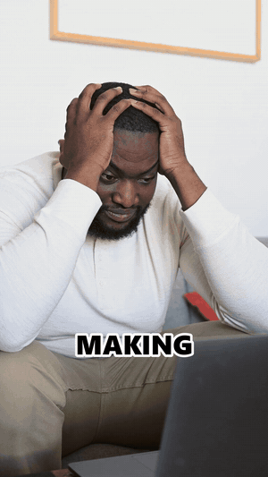
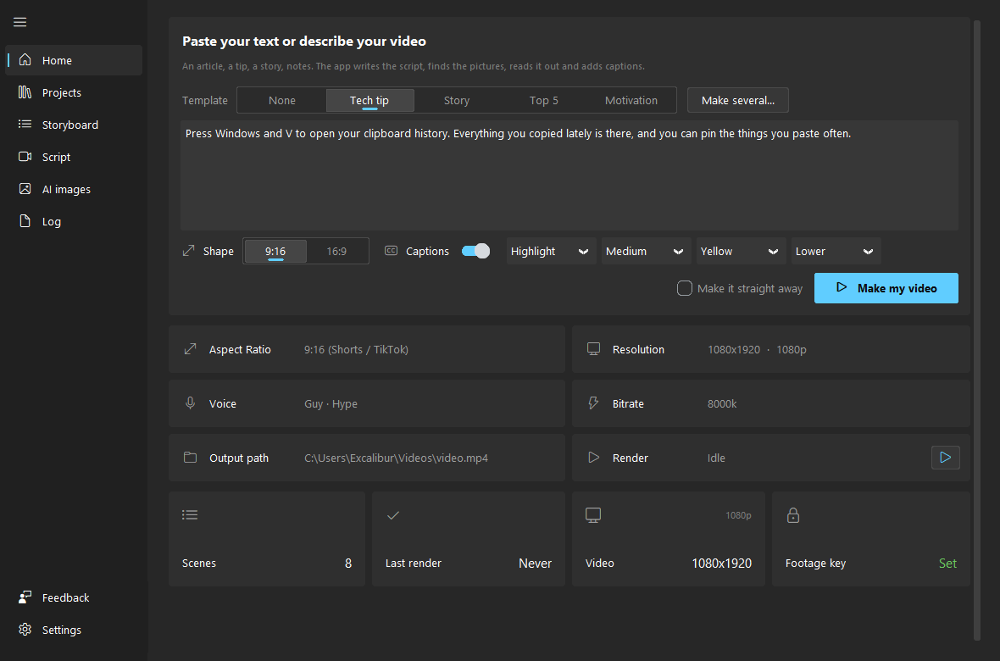
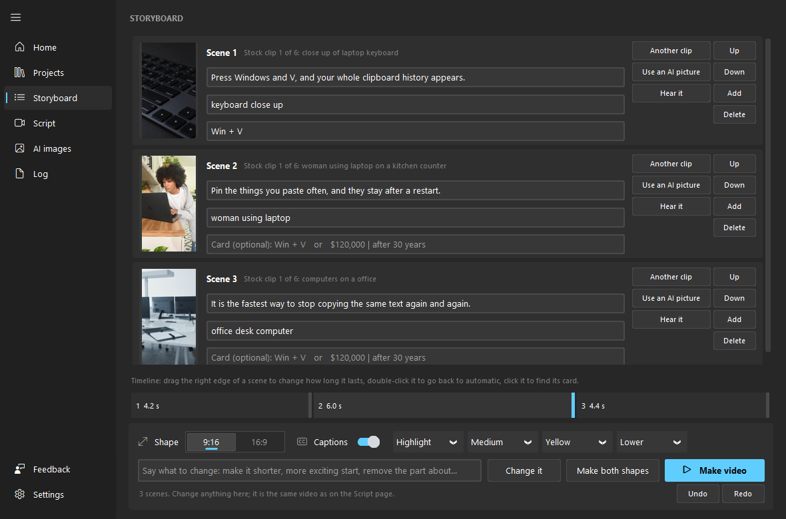
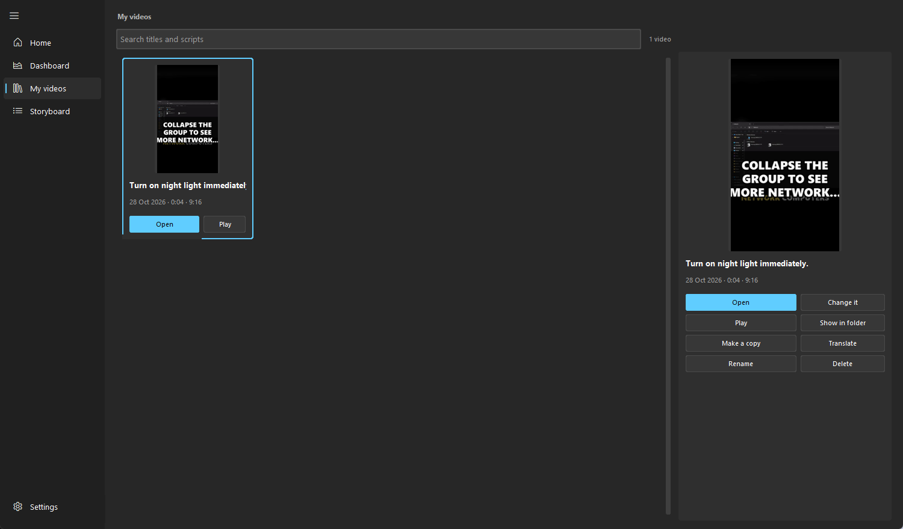
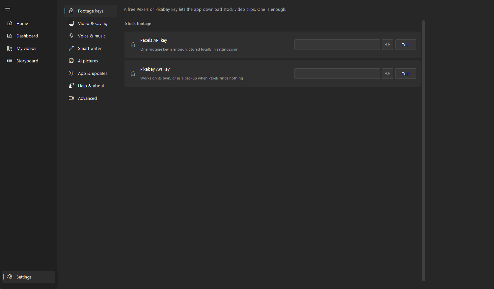
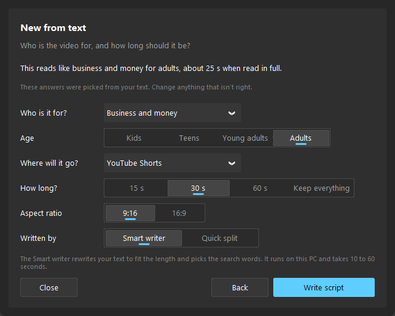
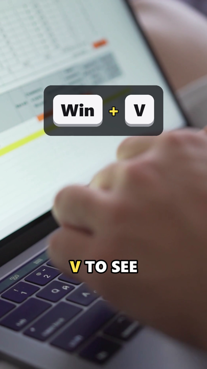
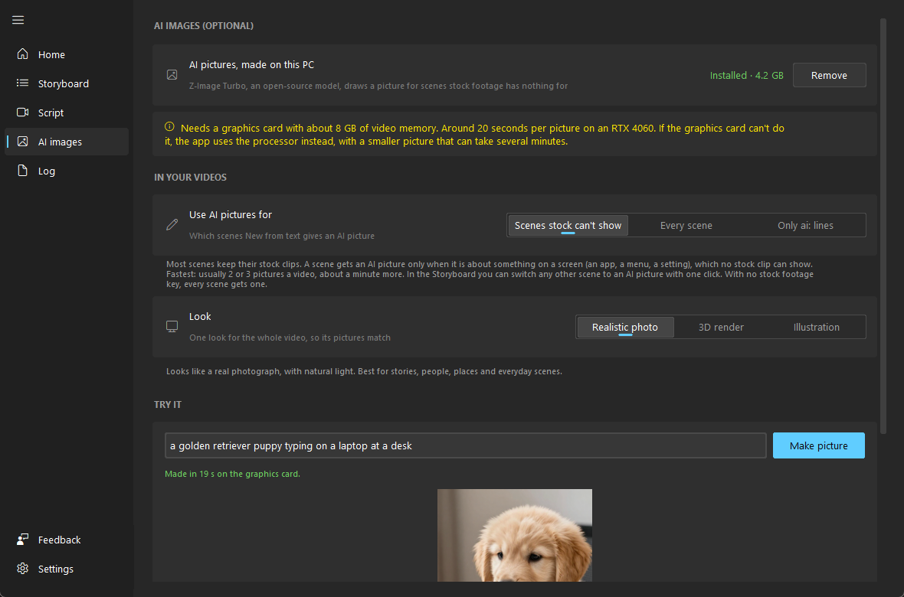
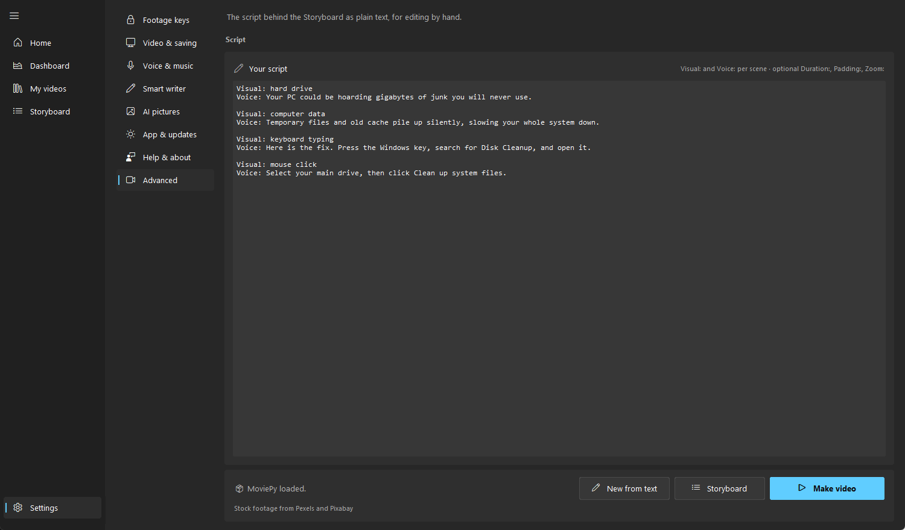
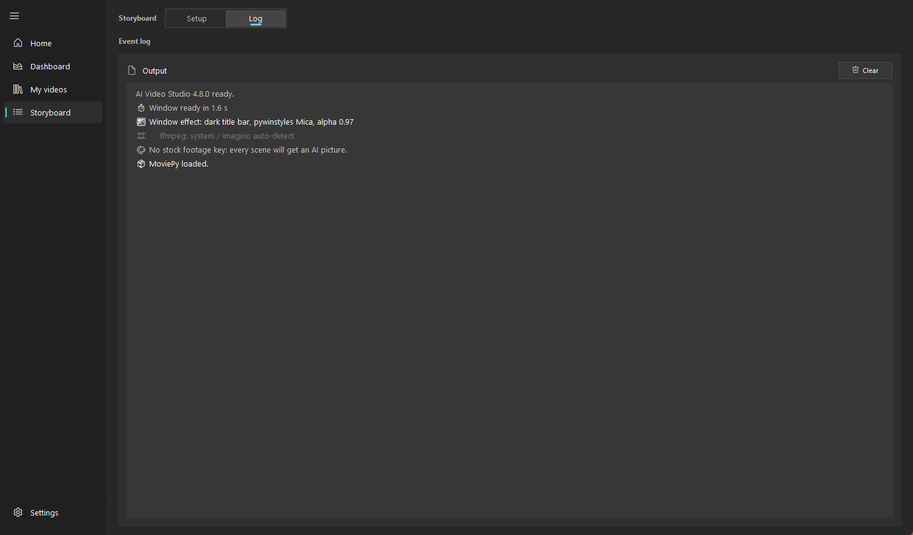

# AI Video Studio

A professional-grade automated video generation tool that turns written scripts
into fully edited, high-quality videos. Pick the visuals in words, write the
narration, and it fetches matching stock footage from Pexels, generates a neural
voiceover, and renders a 1080p or 720p MP4 in portrait or landscape.

<p align="center">
  <br>
  <em>Made from a six-scene script: footage, voice and captions are automatic.</em>
</p>

## Features
- **Paste text, get a video:** The Home page is one box and one button. Paste an article, a tip or your notes and press **Make my video**.
- **Storyboard:** See the video as a card per scene before it is made. Change a line, swap a clip, make another AI picture, reorder scenes, and hear any line read out.
- **Projects:** Every video you make is kept on the Projects page. Open it again in the Storyboard, change it, make a copy in the other shape or voice, rename it, search. An unfinished Storyboard is kept as a draft.
- **Tell it what to change:** Type "make it shorter" or "more exciting start" and the built-in AI rewrites the script; you see what changed before anything is rendered.
- **Paste any text, get a script:** Paste plain text, say who the video is for and how long it should be, and a built-in open-source AI writes the script. It runs on your PC: no account, no key, nothing sent anywhere.
- **Automated Stock Footage:** Automatically fetches relevant video clips from Pexels or Pixabay, and picks the one whose description fits the scene best.
- **Drawn styles:** Blackboard chalk or flat-colour drawing, each scene drawn on screen. Fast on any PC.
- **Facts from Wikipedia:** Ask for "top 5..." and the Smart writer reads Wikipedia instead of guessing.
- **Templates and batches:** Start from Tech tip, Story, Top 5 or Motivation, or make several videos in one go.
- **Moving AI pictures (beta):** With a graphics card, an AI picture can become a short moving clip.
- **Music included:** Eight public-domain tracks, picked by the video's mood.
- **Two versions in one go:** Optionally render the same script twice with different clips, and keep the better one.
- **Pick a length:** Fit the video to 15, 30 or 60 seconds, with a live estimate as you type.
- **Neural AI Voices, on your PC:** 20 natural-sounding male and female voices from an open-source speech model that runs offline. No account, no key, no service that can be switched off.
- **AI pictures (optional):** With a good graphics card, an open-source image model on your PC draws a picture for the scenes stock footage has nothing for.
- **Animated cards:** Key combos like `Win + V`, big numbers and short lists are drawn over the footage, because no stock clip can show them.
- **Smart Script Parser:** Automatically reads your script line-by-line using `Visual:` and `Voice:` tags.
- **Windows 11 Fluent interface:** Settings-app style segmented controls, smooth page transitions, dark and light themes with Mica, and live render progress.
- **Auto-captions:** The spoken words are burned into the video, a few at a time, with the word being said highlighted. An `.srt` subtitle file is saved too.
- **Watch it straight away:** When a render finishes, the video plays inside the app, with sound.
- **Ready to post:** Every video gets a thumbnail and a suggested title, description and tags, with Copy buttons. Nothing is posted for you.
- **Other languages:** Make the same video in Spanish, French, Italian, Portuguese or Hindi.
- **Sound effects:** A soft whoosh on each cut and a pop when a card appears, made by the app itself.
- **Portrait or landscape:** 9:16 for Shorts and TikTok, 16:9 for YouTube, at 1080p or 720p.
- **End-to-End Automation:** Fetches, generates, matches duration, and stitches everything into a final `.mp4`.

## Download

Get the latest [release](../../releases/latest):

| | |
|---|---|
| **`AIVideoStudio-x.y.z-setup.exe`** | Normal install. Adds a Start menu entry and an uninstaller. Installs for your user only, so it never asks for administrator rights. |
| **`AIVideoStudio-x.y.z-portable.zip`** | No install. Unzip anywhere and run `AIVideoStudio.exe`. |

**No Python, no pip, no separate FFmpeg install** — everything is in the download.

**Updating:** the app tells you when a newer version is out. Press **Update now**:
the app downloads the new version, checks it, puts it over the old one and reopens.
This works for the installed version and, from 4.2.1, the portable one (unless its
folder is somewhere Windows won't let it write, such as Program Files). Your settings,
API keys, projects and the Smart writer are kept.
(Running from source still needs all three; see below.)

**The AI models are a separate 2.9 GB download:** the voice (0.4 GB) and the Smart writer (2.5 GB). The installer fetches both during setup; the portable version fetches the voice the first time you make a video and the Smart writer the first time you use **New from text**. They are downloaded once and kept when you update the app. See [New from text](#new-from-text) below.

### Windows will warn you the first time

These builds are not code-signed, because a signing certificate costs several
hundred dollars a year. SmartScreen will show **"Windows protected your PC"**,
where the only obvious button is *Don't run*. Click **More info** → **Run anyway**.

You can confirm you have the real file by checking its hash against
`SHA256SUMS.txt` on the release page:

```powershell
Get-FileHash .\AIVideoStudio-4.5.0-setup.exe -Algorithm SHA256
```

## The quick way

1. On **Home**, paste your text into the box and press **Make my video**.
2. Check the three answers the app suggests (who it is for, how long, where it will be
   posted) and press **Write script**, then **Use this script**.
3. The **Storyboard** opens: one card per scene, with its picture and its line. Change what
   you don't like, then press **Make video**.

Tick **Make it straight away** on Home to skip step 3.

**Templates:** above the box, pick **Tech tip**, **Story**, **Top 5** or **Motivation**
and the questions in step 2 come already answered (who it is for, how long, captions,
cards, the music's mood). **Top 5** also writes the video as a countdown.

**Make several:** paste one text or topic per block, with an empty line between them, and
press **Start**. Each becomes its own script and video, one after another, and its own card
on the Projects page. Up to 20 at a time.



## Storyboard

The Storyboard is the same video as the script, shown as cards. Everything you change
there is written into the script, and the other way round.



| On each card | What you can do |
|---|---|
| The picture | **Another clip** steps through up to six stock clips. **Make picture** / **Make another** draws the AI picture now, and the video then uses exactly that one. **Use an AI picture** and **Use a stock clip** switch the scene between the two. |
| The line | Edit it in place. **Hear it** reads that one line in the chosen voice. |
| The search words or picture description | Edit in place; the picture reloads. |
| The card | Add, change or remove a `Win + V` style card. |
| Up, Down, Add, Delete | Change the order, add a scene, remove one. |

**Undo** and **Redo** (or Ctrl+Z and Ctrl+Y) step back and forward through up to 50
changes made in the Storyboard, including a "Change it" rewrite.

**Timeline:** under the cards, one block per scene, as wide as the scene is long. Drag a
block's right edge to set how long that scene lasts (half-second steps, 1 to 30 s; it turns
yellow if the line no longer fits), double-click it to go back to automatic, click it to
jump to its card.

### Tell it what to change

At the bottom of the Storyboard, and in the window that opens when a video is finished,
there is a box: **Say what to change**. Type it in your own words and press **Change it**:

- "make it shorter", "make the start more exciting", "sound more serious", "write it for kids"
- "remove the part about pinning", "put the last scene first"
- "the third picture should be a cat on a laptop", "add a line telling people to subscribe"

The Smart writer rewrites the script, the Storyboard marks the scenes that **changed**, and
nothing is rendered until you press **Make video**. Scenes that did not change keep their
clips and pictures.

It changes the script only: not the voice, the captions or the music, which you set on the
Script page. It needs the Smart writer download, and it is a small AI model: if it changes
nothing, or the wrong thing, say it another way or edit the card yourself. Ctrl+Z on the
Script page brings the old lines back.

## Projects

Every video you make is saved as a project: its script, its settings (shape, voice,
captions, look, length, music) and its AI pictures. The **Projects** page shows them as
cards, newest first, with a search box for titles and scripts.



| On each card | What it does |
|---|---|
| **Open** | Puts the video back in the Storyboard with its settings and AI pictures, ready to change and make again. |
| **Change it** | Opens it and takes you to the **Say what to change** box. |
| **Play**, **Show in folder** | The video file. |
| **Make a copy** | The same video in the other shape (9:16 or 16:9) or with another voice. Same shape: the AI pictures are reused. Another shape: new pictures are made. |
| **Rename** | Type a new name and press Enter. |
| **Delete** | Removes the project and its saved pictures. Your video file is kept. |

A Storyboard you leave without making the video is kept too, as a **Draft** card.
Videos made with versions before 4.2 are not listed: their scripts were not saved.

## First run

The very first time, a short four-screen tour shows how the app is used. It is not shown
again after an update; **Feedback → Show the tour** brings it back.

The app needs **one free stock footage key**, from either
[Pixabay](https://pixabay.com/api/docs/) or [Pexels](https://www.pexels.com/api/).
Neither is required: one of the two is enough. The first time you open the app,
a **Welcome** window walks you through it: choose Pixabay or Pexels, open its
page, copy your key, paste it in, and press **Test key** to check it works. You
can reopen the window later from **Feedback → Setup guide**, or paste a key into
**Settings**.

With both keys set, the app searches Pexels first and falls back to Pixabay when
Pexels has nothing good. Scripts that only use your own files (see `local:`
below) need no key at all.

**No key at all?** If you have downloaded [AI pictures](#ai-pictures-optional) (they need a
good graphics card), the app draws a picture for every scene and never asks for a key. When
the video is done it mentions once that a free key would add real video clips; tick **Don't
show again** and it won't.

Keys are stored in plain text in `%APPDATA%\AIVideoStudio\settings.json`.



## New from text

You don't have to write the script format by hand. Paste your text on **Home**, or press
**New from text** on the Script page:

**An idea works too.** Type a short request instead of a text, such as "write a scary story
about being followed at night" or "make a video about black holes", and the Smart writer
writes it from scratch: for a story, something happens in every scene (a start, rising
tension, a turn, an ending). A pasted text is rewritten as before.

1. **Paste your text** and press **Analyse**. Any plain text works: notes, an
   article, a list.
2. **Check the answers.** The app reads the text and picks who the video is for
   (what it is about, the age group), how long it should be and its shape. You
   also choose where it will be posted. Change anything that isn't right.
3. **Write script.** Read the result, press **Write again** if you want a
   different version, then **Use this script** to put it in the editor.



There are two writers:

| | Smart writer | Quick split |
|---|---|---|
| What it does | Rewrites and shortens your text to fit the length, opens with a hook, and picks search words for each scene | Keeps your words exactly as written, splits them into scenes, and guesses search words from each sentence |
| Speed | About 10 to 60 seconds | Instant |
| Needs | A one-time 2.5 GB download and about 8 GB of RAM | Nothing |

If a text is too long for the length you chose, the Smart writer shortens it.
Quick split leaves out the least important sentences, lists them with a **Put
back** button, and offers the shortest length that keeps everything.

What the audience changes: the voice, the speaking pace and how short the scenes
are. The Smart writer is also told who it is writing for, but expect the wording
to change only a little between audiences.

### About the Smart writer

The Smart writer is [Qwen3 4B](https://huggingface.co/Qwen/Qwen3-4B-GGUF), an
open-source language model (Apache 2.0 licence), run on your PC by
[llama.cpp](https://github.com/ggml-org/llama.cpp) (MIT licence).

- **Private:** your text never leaves your computer. No account and no key.
- **One download:** 2.5 GB, saved in `%LOCALAPPDATA%\AIVideoStudio\models`. A
  cancelled download carries on from where it stopped. **Settings → Smart
  writer** shows its state and can download or repair it.
- **Memory:** it uses about 5 GB while it writes and gives it back straight
  after. If the PC is short of memory, too slow, or anything else goes wrong, the
  app uses Quick split and tells you why.
- **Graphics card:** turn on **Settings → Use the graphics card** to run it on a
  dedicated NVIDIA, AMD or Intel card instead of the processor. On an RTX 4060 a
  script takes about 3 seconds instead of about 20. It is off by default, needs
  about 3 GB of video memory, and goes back to the processor by itself if the
  card can't be used.
- **It can be wrong.** It is a small model. Read the script before you render:
  it sometimes changes a detail, such as "every workday" becoming "every day".

## Writing a script

Every line starts with `Visual:` or `Voice:`, in pairs. `Visual:` is the Pexels
search; `Voice:` is what gets spoken over it. One pair is one scene.

```
Visual: frustrated person typing laptop
Voice: Did you know you are copying and pasting completely wrong on Windows?

Visual: hands on glowing keyboard
Voice: Press the Windows key and the letter V to unlock your clipboard history.
```

See [example_script.txt](example_script.txt) for a full worked example.

### Optional per-scene settings

Any scene can add these lines after its `Visual:`, in any order. Scripts without
them work exactly as before.

```
Visual: hard drive
Voice: Your PC is hoarding gigabytes of junk.
Duration: auto
Zoom: in

Visual: local:C:/Users/me/recordings/taskmgr.mp4
Voice: Here is the fix. Open Task Manager.
Duration: 4s
```

| Line | Values | If left out |
|---|---|---|
| `Duration:` | `auto`, or seconds like `4.5s`. A set duration is exact — a longer voice line is cut short, with a warning in the log. | `auto`: the scene lasts as long as its voice line, plus padding |
| `Padding:` | seconds like `0.5s` of pause after the voice line (ignored when `Duration:` is set) | the **Scene padding** setting |
| `Zoom:` | `in`, `out`, or `none` — a slow 1.0× → 1.1× Ken Burns zoom | a subtle zoom, stronger on photos and still footage |

| `Card:` | text drawn over the footage — see **Cards** below | no card |

A scene with no `Voice:` line is a silent shot and needs a `Duration:`, e.g. a
logo held for `Duration: 2s`.

When a voice line runs longer than 6 seconds and has no set duration, the scene
cuts between **two different clips** halfway through, to keep the pace up.
Scenes join with a short 0.3 s crossfade.

### Cards

Stock footage cannot show a keyboard shortcut or a figure, so a scene can put it
on screen with a `Card:` line. What you write picks the look:



| You write | You get |
|---|---|
| `Card: Win + V` (parts joined by `+`) | keycaps, one per part |
| `Card: $120,000` or `Card: $120,000 \| after 30 years` | a big line, with a small one under it |
| `Card: Paste; Pick a length; Done` (parts split by `;`) | a list, the items appearing one by one |

Anything else is shown as a big title. The card pops in as its scene starts and
fades out as it ends, in the half of the frame the captions are not using, in
your caption colour.

**New from text** adds cards by itself when a line says to press keys ("Press
the Windows key and V") or is about a dollar amount, a percentage or a large
number. At most half the scenes get one. They arrive as `Card:` lines in the
script, so you can edit or delete them; **Settings → Add cards automatically**
turns this off.

### AI pictures (optional)

Stock sites have no clip of a clipboard history window or a robot holding your
product. The **AI images** tab can download an open-source image model
([Z-Image Turbo](https://huggingface.co/Tongyi-MAI/Z-Image-Turbo)) that draws those
pictures on your own PC. Nothing is sent anywhere, and nothing is installed unless you
press **Download** there.



- **It needs a graphics card with about 8 GB of video memory.** A picture takes around
  20 seconds on an RTX 4060. If the graphics card can't make the picture, the app tries
  again on the processor with a smaller picture, which can take several minutes, and
  remembers that for next time. It needs about 5 GB of free memory for a full-size picture
  and makes a smaller one with less.
- **The download is about 4.2 GB**, once. It also uses the Smart writer's file.
- Ask for a picture in any script with `ai:` and a description:

  ```
  Visual: ai: a laptop screen showing a list of copied text, a hand on the keyboard
  Voice: Press the Windows key and V to open your clipboard history.
  ```

  The picture is made while the video is made and gets the same slow zoom as a photo.
- **New from text** writes the descriptions for you. Under **Use AI pictures for** choose
  the scenes stock footage can't show (the default), every scene, or only your own `ai:`
  lines. **Look** sets one style for the whole video.
- If a picture can't be made (not enough free memory, for example), that scene uses stock
  footage instead and the Log says why.

**Speed.** The **Speed** row in the AI images tab chooses the picture size: **Fast**
(384 x 672), **Balanced** (480 x 848) or **Best** (576 x 1024). Smaller pictures are made much
faster and enlarged to the video's size once, carefully, before the slow zoom. On a PC without
a graphics card the app starts on Fast, never goes above it on the processor, gives only the
first two scenes an AI picture by default, and before a long render says how long it will take
and offers to make two pictures and use them again. **Test speed** times a tiny picture a few
ways on the processor and keeps the fastest; **Copy results** puts the numbers on the clipboard.
**Settings → AI picture threads** sets the thread count by hand.
**Make pictures on** chooses where pictures are made: **Auto** (the graphics card, and the
processor if the card fails), **Graphics card** only (a scene whose picture fails uses a stock
clip), or **Processor** only.

You are responsible for what you ask it to draw and for how you use the pictures.

### Drawn styles: Blackboard and Drawing

**Style** (on Home next to the templates, and in Settings): **Blackboard** turns every scene
into white chalk lines on a dark board, like a teacher explaining; **Drawing** turns it into a
simple drawing with flat colours and dark outlines. Each scene draws itself on screen in its
first two seconds, then stays. The **Explainer** template uses Blackboard.

It is made from the picture each scene already has (a stock clip's middle frame, an AI
picture or your own image) with simple image maths, not AI, so it is quick on any PC: about
2 seconds a scene here, and the whole render is no slower than a normal one. Busy stock clips
make busy drawings; simple pictures make the best ones.

### Facts from Wikipedia

When you type an idea that asks for facts ("top 5...", "fastest...", "latest..."), the Smart
writer first reads the best matching Wikipedia pages and is told to use only what they say;
the window names the pages. Only the search words leave your PC. It is much better than the
model's own guesses, but not perfect (rankings and "newest" models can still come out
wrong), so read a fact video before posting it. **Settings → Look facts up on Wikipedia**
turns it off.

### Moving pictures (beta, graphics card only)

In the **AI images** tab, **Make AI pictures move** downloads Wan 2.2 TI2V 5B (8.5 GB, Apache
2.0), and **Which pictures move** turns an AI picture into a short moving clip instead of a
still with a slow zoom: the first AI scene of each video, or every AI scene. The picture is the
clip's first frame, so the scene still shows what you saw in the Storyboard; the clip plays
forward and then backward, so it fills a longer scene without a jump.

Measured on an RTX 4060 (8 GB): **about 1.5 minutes per clip**, 6.9 GB of graphics memory.
It needs a graphics card: on the processor it stays off, and the scene keeps its still
picture. If a clip can't be made, the still picture is used and the video is made anyway.

### Your own footage and images

Start a `Visual:` with `local:` to use a file instead of stock footage — a screen
recording, your own b-roll, a screenshot or a photo:

```
Visual: local:C:/Users/me/Videos/demo.mp4
Visual: local:screenshots/settings.png
```

Videos: `.mp4 .mov .mkv .webm .avi .m4v` (their own sound is dropped).
Images: `.png .jpg .jpeg .webp .bmp`. A relative path is looked up in the folder
the video is being saved to. Every `local:` file is checked before anything is
downloaded, so a typo fails straight away.

### Background music

The app comes with eight public-domain tracks (CC0: free to use in any video, including
monetised ones, no credit needed). With the track set to **Auto (fits the video)**, the app
picks one by what the video is about: calm for tech and money, upbeat for motivation and
kids, dramatic for stories. Music is on by default for new installs.

Turn on **Settings → Background music** and pick a track. It plays at about 25%
volume in the pauses and dips to about 9% whenever the voice is speaking, easing
down just before each line and back up after. Drop tracks into
`Documents\AI Video Studio\Music` (**Open folder**), or **Browse** for any audio
file.

### Thumbnail, title, description and tags

After every render the app saves `name.thumbnail.jpg` beside the video: the sharpest
frame from a pause between lines (so no caption is in the way) with the title across it,
in the video's shape (720x1280 or 1280x720). The Render complete window has **Open
thumbnail**, and the project card shows it.

The same window shows a title, a short description and tags for posting, written by the
Smart writer from what the video says, each with a **Copy** button. They are also saved as
`name.upload.txt`. Without the Smart writer the first line is the title and the search
words are the tags. Nothing is uploaded or posted anywhere.

### Other languages

**Make it in another language** (on a project card, and in the window that opens when a video
is finished) makes a copy of the video in **Spanish, French, Italian, Portuguese (Brazil)** or
**Hindi**. The Smart writer translates the lines; the pictures, clips and cards stay; the voice
and the captions change to that language. The copy opens in the Storyboard first, because the
Smart writer is a small AI: its translations are understandable but have mistakes, so read the
lines (or have someone who speaks the language read them) before making the video. Each
language has its own voices in the voice list (Spanish, Italian, Portuguese and Hindi a female
and a male one, French a female one).

### Cuts on the beat and smart framing

**Settings → Cuts on the beat, smart framing** (on by default). With music on, each change
of scene moves to the nearest beat of the track (at most a quarter of a second, and never
before the line has been said). And when a wide clip is cut down for a Short, or the slow
zoom moves in, the frame heads toward the part of the picture with the most detail (a
person, hands, a screen) instead of always the middle.

### Sound effects

**Settings → Sound effects** (on by default): a soft whoosh just before each cut and a short
pop when a card appears, quiet under the voice. The app makes these sounds itself, so there
is nothing to download and no licence to worry about.

### Start and end cards

**Settings → Start and end cards**: a 2-second card with your channel name before every
video, and one after it (default "Subscribe for more"). Both are off until you turn them on.
They are added when the video is made, not written into your script.

### Both shapes at once

**Make both shapes** on the Storyboard makes the video in its shape, then in the other one
(9:16 and 16:9), saved side by side as `name.mp4` and `name (16x9).mp4` and kept in the same
project. AI pictures are made again for the second shape.

### Voices

Pick a voice on the **Script** page and press **▶ Preview Voice** to hear it
before rendering. All voices are free — no account or key needed.

The voices are spoken on your PC by [Kokoro](https://huggingface.co/hexgrad/Kokoro-82M),
an open-source speech model (a one-time 0.4 GB download), so they work with no
internet. Up to version 3.7 the app used Microsoft Edge's online voices; that
service stopped answering in October 2026. The old voices are still there under
**Settings → Voice → Use Microsoft's online voices**, in case it comes back.

| Group | Voices | Delivery |
|---|---|---|
| Viral / Shorts | Max, Cole, Zoe, Mia (US) | fast and punchy, very short pauses |
| Tech / Short-Form Hype | Guy, Jenny, Steffan (US) | a bit faster and brighter, short pauses |
| Deep / Storyteller | Christopher, Eric, Roger (US) | a bit slower and lower, longer pauses |
| Professional / Tutorial | Aria, Andrew, Ava (US) | clear, even pace |
| Accents & Regional | Ryan, Sonia, William (UK) | natural pace |
| Classic (low quality) | the four voices from earlier versions | read exactly as before, no studio processing |

The first four groups get **studio processing**: natural breath pauses at
commas and full stops, then broadcast mastering — low-end warmth, compression
so every word is audible, and loudness set to −14 LUFS, the level YouTube
Shorts, Reels and TikTok play at.

### Two versions

Set **Versions** to `2` and the app renders the script twice: the same voice and
captions, different clips in every stock scene. They are saved as `name.mp4` and
`name (version 2).mp4`, each with its own subtitles and credits file, and the
Render complete window lets you play both. The voice is made once, so two
versions take well under twice as long as one.

### Video length

The Script page shows about how long your script will be, and updates as you
type. It is an estimate: the voice paces every line a little differently.

Set **Length** to `15 s`, `30 s` or `60 s` to fit the video to that length. The
app adjusts the pauses between scenes first. If that is not enough, it speeds
the voice up or slows it down by at most 15%, keeping its pitch, and the
captions follow. A script that is far too long or too short is rendered as
close as it gets, and the Log tells you roughly how many words to cut or add.
Scenes with their own `Duration:` or `Padding:` line are left exactly as written.

### Stopping a render

While a video is rendering, the Render button becomes **Cancel**. The render
stops within a second or two and leaves no unfinished file behind.

### Captions

Captions are on by default: the words appear on screen as they are spoken, timed
from the voice itself, so they stay in sync without any setup. Change how they
look, or turn them off, in the **Captions** row on the Script page or under
**Settings → Captions**. Scenes without a `Voice:`
line have no captions.

The `.srt` file saved next to the video can be uploaded to YouTube as real
subtitles (**Subtitles → Upload file → With timing**).

### Footage credits

Next to each video the app writes `<name>.credits.txt`, listing the Pexels or
Pixabay creator and page for every stock clip used — handy for a YouTube
description.



## Options

| Setting | Choices |
|---|---|
| Aspect ratio | `9:16` for Shorts / TikTok / Reels, `16:9` for YouTube |
| Resolution | `1080p` (8000k bitrate) or `720p` (5000k) |
| Scene padding | `0s`, `0.25s` (default), `0.5s` or `1s` of pause after each voice line |
| Voice | 20 free neural voices that run on your PC — see **Voices** below |
| Length | `Auto` (default), or fit to `15 s`, `30 s` or `60 s` — see **Video length** below |
| Versions | `1` (default) or `2`: the same video twice, with different clips |
| Saving | **Ask where to save each video** (default): a Save window opens for every render, like a browser download. Off: videos go to the default path and are numbered `name (2).mp4`, `name (3).mp4`… so none is overwritten |
| Captions | On or off. Style: `Highlight`, `One word` or `Plain`. Size: `Small`, `Medium`, `Large`. Highlight: yellow, green, cyan, pink, white or black. Position: `Lower`, `Center` or `Top` |
| Background music | On or off, with any track; ducks under the voice automatically |
| Theme | Dark or light, with a Mica backdrop on Windows 11 |

Output size follows both settings: 9:16 at 1080p is 1080×1920, 16:9 at 720p is
1280×720, and so on.

## Where things go

| | |
|---|---|
| Settings | `%APPDATA%\AIVideoStudio\settings.json` |
| Projects | `%APPDATA%\AIVideoStudio\projects`: script, settings, thumbnail and AI pictures of each video (about 1 MB a picture). The videos themselves stay where you saved them |
| Rendered video | Wherever you choose in the Save window; it opens in your Videos folder the first time. An existing video is only replaced if you confirm it |
| Footage credits | `<video name>.credits.txt`, next to the video |
| Subtitles | `<video name>.srt`, next to the video (when captions are on) |
| Thumbnail | `<video name>.thumbnail.jpg`, next to the video |
| Title, description, tags | `<video name>.upload.txt`, next to the video |
| Your music | `Documents\AI Video Studio\Music` |
| Log file | `%APPDATA%\AIVideoStudio\logs\app.log`. It stays on your PC |
| Search cache | `%APPDATA%\AIVideoStudio\cache`, kept for 24 hours (Pixabay's terms require it) |
| Temporary clips | `%TEMP%\AIVideoStudio`, deleted after each render |

## If the video can't be saved

If the folder you chose refuses the file, the app does not lose the render. It
saves the video to your Videos folder, then Desktop, then Downloads, then a temp
folder, and the Log says which one it used.

The usual cause on school and work PCs is Windows **Controlled folder access**
(ransomware protection), which blocks unknown programs from writing to Videos,
Documents and Desktop, and makes Save windows answer "file not found". Saving to
Downloads or another folder works, or an administrator can allow the app under
**Windows Security → Virus & threat protection → Ransomware protection**.

## Reporting a problem

When a render fails, the error window has a **Report this** button, and
**Feedback → Report a problem** works at any time. Both open a report you can
read and edit before anything happens: the app version, your Windows version,
a few settings, the error, and the last lines of the log. API keys, your Windows
user name and the spoken lines of your script are removed first.

Nothing is sent by the app. **Open GitHub issue** opens a prefilled issue in
your browser for you to submit, and **Copy to clipboard** lets you paste the
report anywhere else.

## Needs an internet connection

Stock footage (Pexels, Pixabay) comes from the network. Your own `local:` files,
the rendering, the voice and the Smart writer are local; the voice and the Smart
writer only need the internet once, for their downloads.

## AI Script Generation Prompt

You can use ChatGPT, Claude, or Gemini to automatically write scripts formatted specifically for this app. Copy and paste the prompt template below into your AI of choice:

---

> **Prompt:**
>
> "You are an expert short-form video scriptwriter for TikTok and YouTube Shorts.
>
> I need a 45-second high-retention script about: **[INSERT TOPIC HERE]**
>
> Strict Formatting Rules:
> 1. Output ONLY pairs of lines starting with `Visual:` and `Voice:`.
> 2. Do NOT include scene numbers, timestamps, markdown asterisks, or extra conversational text.
> 3. `Visual:` must contain 2 to 4 simple, searchable stock video keywords that can be found on Pexels (e.g., 'typing on laptop keyboard', 'neon lightning bolt', 'frustrated person at computer').
> 4. `Voice:` must contain punchy, engaging spoken dialogue (no emojis, no stage directions).
> 5. Create 6 to 8 scene pairs (roughly 100-120 words total).
>
> Example output format:
> Visual: slow broken laptop
> Voice: Is your computer taking forever to start up?
>
> Visual: hands typing on keyboard
> Voice: Here is a simple setting tweak to fix it in seconds."

---

### How to use:
1. Replace `[INSERT TOPIC HERE]` with your video idea (e.g., *'3 hidden iPhone camera features'* or *'How to clear cache on Windows'*).
2. Copy the AI's exact text output.
3. Paste it directly into the **Script** page's box and click **Render Video**!

## Run from source

Needs **Python 3.10+**. FFmpeg comes from `imageio-ffmpeg`, so you do not need to
install it separately or add it to PATH.

```bash
git clone https://github.com/bodrumundenizi-beep/free-ai-video-generator.git
cd free-ai-video-generator
pip install -r requirements.txt
python src/ai_video_studio.py
```

The Smart writer also needs llama.cpp, the program that runs its model. This
fetches the pinned, checksum-verified Windows build into `vendor/llama/`:

```bash
python packaging/fetch_llama.py
```

Without it the app still runs and uses Quick split.

## Build the installer yourself

```bash
pip install -r requirements.txt -r requirements-build.txt
python -m pytest
python packaging/make_icon.py
python packaging/fetch_llama.py
pyinstaller --noconfirm --clean packaging/ai_video_studio.spec
"C:\Program Files (x86)\Inno Setup 6\ISCC.exe" /DMyAppVersion=4.5.0 packaging\installer.iss
```

Releases are built automatically by GitHub Actions when a `v*` tag is pushed.



## Code signing policy

The Windows builds are **not code-signed**, so Windows shows a SmartScreen
warning the first time you run them (see [Download](#download) for how to get
past it and how to check the file's SHA-256 hash). Signing is planned once the
project is established enough to qualify for an open-source signing programme.

- **Builds:** every release is built from this repository by GitHub Actions
  ([release workflow](.github/workflows/release.yml)); nothing is built or
  uploaded by hand.
- **Committers, reviewers and approvers:** the repository owner,
  [@bodrumundenizi-beep](https://github.com/bodrumundenizi-beep).

### Privacy

This program does not collect or send any personal data. It connects to other
systems only to do what you ask of it: Pexels and Pixabay to search for and
download stock footage (using your own API keys). The voiceover is made on your
PC; only if you turn on **Use Microsoft's online voices** is your script text sent
to Microsoft Edge's online text-to-speech. On startup it
also asks GitHub for this project's latest version number, to tell you about
updates; that request contains nothing about you, and you can turn it off under
**Settings → Updates**. An update is only downloaded when you press **Update
now**; it comes from this project's GitHub releases and is checked against the
SHA-256 published with the release before it is run. Settings and API keys stay
on your computer.

The Smart writer runs entirely on your computer. Text you paste into **New from
text** is not sent anywhere. The only connection it makes is the one-time
download of the model file from Hugging Face.

The app keeps a log file on your PC to help with problems. It is never sent
anywhere by the app; a problem report quotes from it only when you choose to
send one, and you see the text first.

## Licence

MIT — see [LICENSE](LICENSE).

The released builds redistribute several third-party components under their own
licences, including an LGPL library and a GPL FFmpeg binary. See
[THIRD-PARTY-LICENSES.md](THIRD-PARTY-LICENSES.md).
